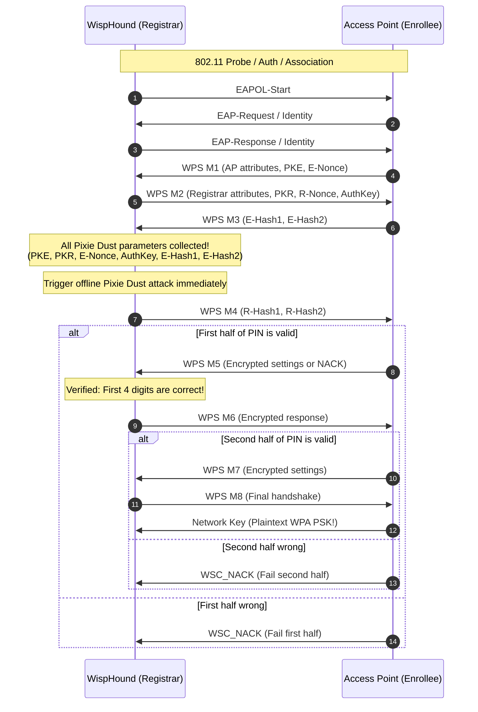

# WispHound 2.0.0

**Next-Generation WPS Reconnaissance, Chipset-Aware Prioritization & Pixie Dust Auditing Engine for Linux.**

WispHound is an advanced, automated Wi-Fi Protected Setup (WPS) reconnaissance and auditing tool designed for penetration testers and security researchers. It automates the detection, classification, and exploitation of vulnerable WPS implementations by inspecting 802.11 management frames, identifying vulnerable chipsets, prioritizing targets susceptible to the **Pixie Dust** offline attack, and executing optimized offline and online attacks.

> [!WARNING]
> **Authorized Auditing and Educational Use Only.**
> WPS auditing actively transmits 802.11 management and EAPOL frames. Only run WispHound against networks and hardware you own or have explicit, documented, written authorization to assess. Unauthorized wireless intrusion is illegal under local, national, and international laws.

---

## Table of Contents

- [Key Features](#key-features)
- [Architecture & Design](#architecture--design)
  - [High-Level Architecture](#high-level-architecture)
  - [Core Components & Modules](#core-components--modules)
  - [WPS Protocol Flow & State Machine](#wps-protocol-flow--state-machine)
  - [Pixie Dust Vulnerability Model](#pixie-dust-vulnerability-model)
  - [Smart Two-Phase Brute-Force Theory](#smart-two-phase-brute-force-theory)
  - [Algorithmic PIN Generators](#algorithmic-pin-generators)
  - [Persistence & Target Database Schema](#persistence--target-database-schema)
- [Requirements & Prerequisites](#requirements--prerequisites)
  - [Operating System & Hardware](#operating-system--hardware)
  - [System Packages](#system-packages)
  - [Python Dependencies](#python-dependencies)
- [Step-by-Step Usage Guide](#step-by-step-usage-guide)
  - [Step 1: Install Dependencies](#step-1-install-dependencies)
  - [Step 2: Prepare Wireless Interface](#step-2-prepare-wireless-interface)
  - [Step 3: Interactive Reconnaissance & Attack](#step-3-interactive-reconnaissance--attack)
  - [Step 4: Autonomous Exploitation Pipeline](#step-4-autonomous-exploitation-pipeline)
  - [Step 5: Direct Targeting with Pixie Dust](#step-5-direct-targeting-with-pixie-dust)
  - [Step 6: Smart Brute-Force & Session Recovery](#step-6-smart-brute-force--session-recovery)
  - [Step 7: Push Button Connect (PBC) Mode](#step-7-push-button-connect-pbc-mode)
  - [Step 8: Headless JSONL Streaming & Logging](#step-8-headless-jsonl-streaming--logging)
  - [Step 9: Reviewing Reports & Querying SQLite Database](#step-9-reviewing-reports--querying-sqlite-database)
- [Command-Line Reference](#command-line-reference)
- [Deep Code Analysis of `wisphound.py`](#deep-code-analysis-of-wisphoundpy)
- [Troubleshooting & FAQs](#troubleshooting--faqs)
- [License](#license)

---

## Key Features

- **Chipset-Aware Intelligence**: Scans beacon and probe responses for WPS Information Elements (`Model`, `Model Number`, `Device Name`, OUI prefixes) and cross-references them against an internal catalog of known Pixie Dust-vulnerable chipsets (Ralink/MediaTek, Realtek, Broadcom, Atheros).
- **Vulnerability-First Prioritization**: Automatically sorts discovered access points by vulnerability probability, highlighting candidates in ANSI color (Cyan = Pixie-vulnerable, Red = WPS-locked, Yellow = Already captured, Green = Custom list match).
- **Automated Exploitation Pipeline (`--auto`)**: Hands-free mode that scans the wireless spectrum, ranks targets by vulnerability, and sequentially attempts Pixie Dust and PIN attacks while bypassing locked access points.
- **Robust `pixiewps` Integration**:
  - Direct parameter passing via sanitized argument lists (no shell invocation vulnerabilities).
  - Strict hexadecimal validation for cryptographic parameters (`PKE`, `PKR`, `E-Nonce`, `AuthKey`, `E-Hash1`, `E-Hash2`).
  - Automatic detection and retry with `--force` (full range search) when initial recovery needs deeper search.
  - Subprocess execution with watchdog timeout controls (`--timeout`).
- **Comprehensive Algorithmic PIN Generation**:
  - Implements standard 24-bit, 28-bit, 32-bit, D-Link, D-Link+1, ASUS, and Airocon algorithms.
  - Large pre-mapped catalog of static vendor PINs (Broadcom, Cisco, Realtek, Upvel, Edimax, Thomson, Huawei, ZTE, CBN, etc.).
  - Priority-preserving deduplication for suggested PINs based on BSSID OUI matching.
- **Blazing Fast O(1) Checksum Cache**: Precomputed 10-million-entry lookup table for the WPS 8th-digit Luhn-like checksum (~10 MB RAM, precomputed in ~2.5s), eliminating calculation overhead during brute force.
- **Smart Two-Phase Online Brute Force**: Reduces the 8-digit PIN search space from $10^8$ (100,000,000) down to a maximum of $10^4 + 10^3 = 11,000$ attempts by validating the first half at WPS Message M5 and the second half at M7.
- **Lockout Prevention & Safety Engine**: Actively monitors consecutive `WSC_NACK` responses; initiates an exponential backoff and cool-down timer (`--cool`) after 3 failures to prevent AP lockout.
- **Relational Target Database (SQLite)**: Persists targets, chipsets, attack attempts, success flags, known PINs, and recovered WPA PSKs across sessions in `~/.WispHound/targets.db`. Known PINs are automatically tried first upon re-encountering an AP.
- **Dual Credential Reporting**: Appends recovered network credentials (ESSID, BSSID, WPS PIN, WPA PSK, Timestamp) to structured `reports/stored.txt` and RFC-compliant `reports/stored.csv`.
- **JSONL Structured Telemetry (`--json`)**: Streams real-time NDJSON / JSON Lines events to stdout for integration with external dashboards, automated scripts, and SIEMs.

---

## Architecture & Design

### High-Level Architecture

WispHound orchestrates low-level Linux wireless utilities, raw socket IPC, cryptographic engines, and an embedded database into a unified auditing framework:

```
                      +---------------------------------------+
                      |             WispHound CLI             |
                      |     (Argument Parser & Controller)    |
                      +-------------------+-------------------+
                                          |
        +---------------------------------+---------------------------------+
        |                                 |                                 |
        v                                 v                                 v
+------------------+             +------------------+             +-------------------+
|   WiFiScanner    |             |    Companion     |             |      TargetDB     |
| (iw scan parser) |             | (WPS Orchestr.)  |             | (SQLite Engine)   |
+--------+---------+             +--------+---------+             +---------+---------+
         |                                |                                 |
         | Raw frame                      | UNIX Domain Datagram Socket     | Upsert targets,
         | parsing                        | (/tmp/wpas_ctrl)                | store PSK & PIN
         v                                v                                 v
+------------------+             +------------------+             +-------------------+
|  Linux Kernel    |             |  wpa_supplicant  |             | ~/.WispHound/     |
|  (nl80211 / iw)  |             | (-K -d debug)    |             |   targets.db      |
+------------------+             +--------+---------+             +-------------------+
                                          |
                                          | Intercepts M1..M8,
                                          | extracts E-Nonce, PKR,
                                          | PKE, AuthKey, E-Hash1/2
                                          v
                                 +------------------+
                                 |   PixiewpsData   |
                                 | (Hex Validation) |
                                 +--------+---------+
                                          |
                                          | Subprocess (argv list)
                                          v
                                 +------------------+
                                 |     pixiewps     |
                                 | (Offline Cracker)|
                                 +------------------+
```

---

### Core Components & Modules

1. **`WiFiScanner`**:
   - Executes `iw dev <interface> scan` and parses raw Wi-Fi beacons and probe response IE tags using regular expressions.
   - Extracts BSSID, ESSID (handling non-printable Latin-1/UTF-8 escape sequences), RSSI level (dBm), security suites (WEP, WPA, WPA2, Mixed, Open), WPS lock state, and WSC metadata (`Model`, `Model Number`, `Device Name`).
   - Runs `_classify_pixie_vuln()` against `PIXIE_VULNERABLE_CHIPSETS` to tag vulnerable hardware.
   - Sorts networks with a multi-tiered key: Pixie-vulnerable first, unlocked APs before locked APs, and highest RSSI power.
   - Formats the visual table with ANSI coloring and uses `wcwidth.wcswidth()` to ensure exact column alignment regardless of wide Unicode or Asian characters in ESSIDs.

2. **`Companion`**:
   - The central attack harness. Spawns an isolated `wpa_supplicant` instance inside a temporary directory (`tempfile.mkdtemp()`) configured with `ctrl_interface` UNIX domain datagram sockets (`socket.AF_UNIX`).
   - Enables debug logging (`-K -d`) in `wpa_supplicant` to surface raw cryptographic key material and hexdumps on stdout.
   - Communicates bidirectionally via socket datagrams (`WPS_REG`, `WPS_PBC`, `WPS_CANCEL`).
   - Implements a resilient event loop reading `wpa_supplicant`'s stdout to track authentication, association, EAPOL exchanges, M1–M8 message construction, and WSC NACKs.

3. **`PixiewpsData`**:
   - Cryptographic parameter container holding Enrollee Public Key (`PKE`), Registrar Public Key (`PKR`), Enrollee Nonce (`E-Nonce`), WPS Authentication Key (`AuthKey`), and PIN Hashes (`E-Hash1`, `E-Hash2`).
   - Performs strict input sanitization: validates that all 6 fields match exact required hex lengths (384, 384, 32, 64, 64, 64) and consist purely of hex characters (`0-9A-F`).
   - Spawns `pixiewps` directly using argument lists (avoiding `shell=True` vulnerabilities).

4. **`WPSpin` & Checksum Table**:
   - Algorithmic PIN generator containing mathematical implementations for vendor-specific PIN algorithms.
   - Checksum Calculation: WPS PINs are 8 digits where the 8th digit is a checksum computed over the first 7 digits.
   - Performance: `_build_checksum_table()` creates an `array('b')` with 10,000,000 precalculated entries in memory (~10 MB). Checksum lookup takes $O(1)$ time, eliminating tens of thousands of modulus and division operations during brute force.

5. **`TargetDB` (SQLite Engine)**:
   - Embedded relational database stored at `~/.WispHound/targets.db`.
   - Records AP metadata, vulnerability flags, WPS lock status, attempt counters, successful pins, and plaintext WPA keys.
   - Stores OUI prefix mappings (`oui_vendor` table) populated with built-in entries and extendable via custom files (`--oui`).

6. **`ConnectionStatus` & `BruteforceStatus`**:
   - Tracks real-time connection state, last received WPS M-message, NACK counters, lockout flags, and recovered PSKs.
   - Provides moving-window statistics (PIN rate in seconds/PIN and percentage progress) over a 15-sample deque during online attacks.

---

### WPS Protocol Flow & State Machine

The Wi-Fi Protected Setup (WPS) protocol exchange operates over EAP (Extensible Authentication Protocol) encapsulated in EAPOL (EAP over LAN) frames:



---

### Pixie Dust Vulnerability Model

The **Pixie Dust** attack (discovered by Dominique Bongard in 2014) targets vulnerabilities in the pseudo-random number generator (PRNG) implementations of specific wireless chipsets.

In standard WPS:
- The enrollee (AP) generates two secret 128-bit nonces, `E-S1` and `E-S2`.
- These nonces are used to hash the two halves of the WPS PIN:
  $$\text{E-Hash1} = \text{HMAC-SHA256}_{\text{AuthKey}}(\text{E-S1} \parallel \text{PIN}_{\text{1st\_half}} \parallel \text{PKE} \parallel \text{PKR})$$
  $$\text{E-Hash2} = \text{HMAC-SHA256}_{\text{AuthKey}}(\text{E-S2} \parallel \text{PIN}_{\text{2nd\_half}} \parallel \text{PKE} \parallel \text{PKR})$$
- In vulnerable chipsets (such as Ralink, Realtek, Broadcom, and Atheros), the PRNG used to generate `E-S1`, `E-S2`, and `E-Nonce` either:
  1. Reuses nonces or uses a static seed.
  2. Seeds the PRNG with predictable Unix timestamps ($T_{\text{AP}}$) synchronized with the generation of `E-Nonce`.
  3. Fails to re-seed between the generation of `E-Nonce`, `E-S1`, and `E-S2`.

Because `E-Nonce`, `PKE`, `PKR`, and `AuthKey` are transmitted in WPS messages M1, M2, and M3, an attacker who intercepts M1–M3 can execute an offline attack with `pixiewps`, recovering the PIN in milliseconds without querying the AP again.

#### Vulnerable Chipsets Cataloged in WispHound

| Vendor | Chipset Family | Identified Models / Keywords |
|---|---|---|
| **Ralink / MediaTek** | RT Series, MT Series | `RT2860`, `RT3070`, `RT3572`, `RT5370`, `MT7601`, `MT7612` |
| **Realtek** | RTL8xxx Series | `RTL8188`, `RTL8192`, `RTL8812` |
| **Broadcom** | BCM43xx Series | `BCM4325`, `BCM4329`, `BCM4331` |
| **Atheros** | AR9xxx Series | `AR9271`, `AR9340` |

---

### Smart Two-Phase Brute-Force Theory

Standard brute-force attacks against an 8-digit PIN would require up to $10^8 = 100,000,000$ attempts. However, the WPS specification design inadvertently leaks PIN validation state:
1. **First Half ($10^4 = 10,000$ combinations)**:
   - The first 4 digits of the PIN are tested in Message M4.
   - If the first 4 digits are correct, the AP responds with **WPS Message M5**.
   - If incorrect, the AP responds with **WSC_NACK**.
2. **Second Half ($10^3 = 1,000$ combinations)**:
   - The remaining 3 digits are tested in Message M6.
   - The 8th digit is not independent—it is a deterministic checksum derived from the first 7 digits.
   - If correct, the AP responds with **WPS Message M7**.

**Total Max Attempts**:
$$\text{Max Attempts} = 10^4 + 10^3 = 10,000 + 1,000 = 11,000$$

WispHound's `smart_bruteforce` tests candidate prefixes `0000..9999` using dummy second halves. Once `isFirstHalfValid()` returns true (message count $> 5$), it locks the first 4 digits and iterates `000..999` with automatic checksum generation.

---

### Algorithmic PIN Generators

WispHound includes mathematical generators that calculate default manufacturer PINs directly from the AP's BSSID (MAC address):

| Algorithm | Method / Description | Supported Vendors / Devices |
|---|---|---|
| `pin24` | 24-bit NIC extraction (`mac & 0xFFFFFF`) | Belkin, D-Link, Huawei, Netgear, Zyxel, etc. |
| `pin28` | 28-bit NIC extraction (`mac & 0xFFFFFFF`) | Ralink / MediaTek routers |
| `pin32` | 32-bit NIC extraction (`mac % 0x100000000`) | Asus, Trendnet, Broadcom-based routers |
| `pinDLink` | Bitwise XOR (`nic ^ 0x55AA55`) with nibble shifting and range scaling | D-Link DIR series |
| `pinDLink1` | D-Link algorithm applied to `BSSID + 1` | Newer D-Link revisions |
| `pinASUS` | Modulo transform over MAC byte array | ASUS RT series routers |
| `pinAirocon` | Byte sum permutations scaled across decimal places | Realtek / Airocon APs |
| `pinEmpty` | Transmits an empty PIN string `""` | Routers with NULL WPS PIN misconfiguration |
| Static Tables | Direct lookup of vendor default pins | Cisco, Broadcom (1–6), Realtek (1–3), Upvel, Edimax, Thomson, Huawei HG532x, ZTE H108L, CBN ONO |

---

### Persistence & Target Database Schema

WispHound maintains an embedded SQLite database at `~/.WispHound/targets.db` with the following schema:

```sql
CREATE TABLE IF NOT EXISTS targets (
    bssid TEXT PRIMARY KEY,
    essid TEXT,
    model TEXT,
    model_number TEXT,
    device_name TEXT,
    chipset TEXT,
    pixie_vuln INTEGER DEFAULT 0,
    locked INTEGER DEFAULT 0,
    wps_pin TEXT,
    wpa_psk TEXT,
    last_seen TEXT,
    attempts INTEGER DEFAULT 0,
    success INTEGER DEFAULT 0
);

CREATE TABLE IF NOT EXISTS oui_vendor (
    prefix TEXT PRIMARY KEY,
    vendor TEXT
);
```

#### File-System Artifacts

| Location | Purpose |
|---|---|
| `~/.WispHound/targets.db` | Main SQLite target database. |
| `~/.WispHound/sessions/<BSSID>.run` | Brute-force progress state (saves 4-digit or 7-digit mask for resumption). |
| `~/.WispHound/pixiewps/<BSSID>.run` | Cached Pixie Dust recovered PIN for fast reuse. |
| `reports/stored.txt` | Human-readable log of recovered BSSID, ESSID, PIN, and PSK credentials. |
| `reports/stored.csv` | Semicolon-delimited spreadsheet of credentials with timestamps. |

---

## Requirements & Prerequisites

### Operating System & Hardware

- **Operating System**: **Kali Linux** (recommended), **Parrot OS**, or any Debian/Ubuntu derivative.
- **Privileges**: Root access (`sudo` or UID 0) is mandatory due to raw packet socket and network device manipulation.
- **Wireless Adapter**: An 802.11 wireless network interface supporting monitor/managed modes with standard `nl80211` drivers.
- **MediaTek Hardware Support**: Compatible with MediaTek devices requiring driver activation via `/dev/wmtWifi` (`--mtk-wifi`).

### System Packages

| Package | Minimum Version | Description |
|---|---|---|
| `python3` | $\ge$ 3.6 | Execution runtime. |
| `python3-wcwidth` | Latest | Unicode terminal column formatting. |
| `wpa_supplicant` | Built with `CONFIG_WPS=y` | WPA/WPS state machine and EAPOL client. |
| `pixiewps` | $\ge$ 1.4.0 | Offline WPS PIN recovery tool. |
| `iw` | Latest | Modern nl80211 wireless scanning utility. |
| `iproute2` | Latest | Interface state control (`ip link set <iface> up/down`). |
| `wireless-tools` | Optional | Legacy `wext` driver fallback support. |

### Python Dependencies

WispHound uses Python standard library modules (`argparse`, `codecs`, `collections`, `csv`, `json`, `os`, `pathlib`, `re`, `shutil`, `socket`, `sqlite3`, `statistics`, `subprocess`, `sys`, `tempfile`, `time`, `array`, `datetime`).

The only external Python dependency is `wcwidth`:
```bash
sudo apt install -y python3-wcwidth
# Or via pip:
pip3 install wcwidth
```

---

## Step-by-Step Usage Guide

### Step 1: Install Dependencies

On Kali Linux or Debian-based distributions:

```bash
# Update repository index
sudo apt update

# Install all necessary binaries and libraries
sudo apt install -y python3 python3-wcwidth wpa_supplicant pixiewps iw iproute2
```

Verify that `wpa_supplicant` supports WPS:
```bash
wpa_supplicant -v
# Ensure pixiewps is in PATH:
pixiewps --version
```

---

### Step 2: Prepare Wireless Interface

Identify your wireless interface name:
```bash
iw dev
# Or:
ip link show
```

Ensure the interface is unblocked by `rfkill`:
```bash
sudo rfkill unblock wifi
```

*(Optional but recommended)* Terminate interfering network management daemons to prevent channel jumping during transactions:
```bash
sudo systemctl stop NetworkManager
sudo systemctl stop wpa_supplicant
```

---

### Step 3: Interactive Reconnaissance & Attack

The standard, interactive workflow scans the local Wi-Fi environment, sorts the discovered networks, and displays an aligned, color-coded table:

```bash
sudo python3 wisphound.py -i wlan0
```

1. **Review Network Table**:
   - **Cyan**: High-priority Pixie-vulnerable AP (matching chipset detected).
   - **Yellow**: AP already cracked (credentials saved in DB/reports).
   - **Red**: AP currently WPS-locked (will fail until unlocked).
   - **Green**: Model matches your custom `--vuln-list` file.
2. **Select Target**: Enter the index number `#` of your desired target.
3. **Pixie Dust Prompt**: If the AP has a vulnerable chipset, WispHound automatically asks:
   ```
   [!] Target 00:90:4C:C1:AC:21 looks Pixie Dust vulnerable (Broadcom BCM4329).
   [?] Try Pixie Dust attack first? [Y/n]
   ```
   Pressing Enter or `Y` initiates the offline attack.
4. **Credential Extraction**: Upon successful PIN verification, the plaintext WPA PSK is displayed and saved.

---

### Step 4: Autonomous Exploitation Pipeline

To run hands-free automated scanning, ranking, and sequential exploitation:

```bash
sudo python3 wisphound.py -i wlan0 -A -w
```

To restrict the automated attack strictly to Pixie Dust-vulnerable targets:

```bash
sudo python3 wisphound.py -i wlan0 -A --pixie-only -w
```

The pipeline:
1. Performs a full `iw` wireless scan.
2. Identifies all WPS-enabled access points.
3. Automatically skips locked APs.
4. Attempts Pixie Dust attacks against vulnerable targets.
5. Emits real-time progress and saves successful credentials to `~/.WispHound/targets.db` and `reports/`.

---

### Step 5: Direct Targeting with Pixie Dust

When the target BSSID is already known, target it directly without an interactive scan:

```bash
# Run a Pixie Dust attack against a specific BSSID
sudo python3 wisphound.py -i wlan0 -b 00:14:D1:22:33:44 -K -w

# Display the exact pixiewps command executed
sudo python3 wisphound.py -i wlan0 -b 00:14:D1:22:33:44 -K -X

# Force full-range PRNG keyspace search in pixiewps
sudo python3 wisphound.py -i wlan0 -b 00:14:D1:22:33:44 -K -F
```

---

### Step 6: Smart Brute-Force & Session Recovery

For access points that are not susceptible to Pixie Dust, initiate an online smart brute-force attack:

```bash
sudo python3 wisphound.py -i wlan0 -b 00:14:D1:22:33:44 -B -d 1.5 -w
```

- `-B, --bruteforce`: Engages the two-phase attack engine.
- `-d, --delay 1.5`: Introduces a 1.5-second delay between attempts to avoid AP crashes or rate limits.

#### Session Resumption:
If the brute force is interrupted (`Ctrl+C`), WispHound saves the current mask state to `~/.WispHound/sessions/<BSSID>.run`. When you restart the attack against the same BSSID, WispHound prompts:
```
[?] Restore previous session for 00:14:D1:22:33:44? [n/Y]
```

---

### Step 7: Push Button Connect (PBC) Mode

To pair with an AP that has its physical or virtual WPS Push Button activated:

```bash
# Connect to any AP currently in PBC pairing mode
sudo python3 wisphound.py -i wlan0 --pbc -w

# Connect to a specific BSSID in PBC mode
sudo python3 wisphound.py -i wlan0 -b 00:14:D1:22:33:44 --pbc -w
```

---

### Step 8: Headless JSONL Streaming & Logging

For integration with automated scripts, pipelines, or web interfaces, use JSON line mode:

```bash
sudo python3 wisphound.py -i wlan0 -A --pixie-only -J --trace-log wpas.log > events.jsonl
```

Example JSONL events emitted to stdout:
```json
{"ts": "2026-11-05T19:20:01.123456", "event": "pixiewps_start", "argv": ["pixiewps", "--pke", "...", "--pkr", "...", "--e-hash1", "...", "--e-hash2", "...", "--authkey", "...", "--e-nonce", "..."], "full_range": false}
{"ts": "2026-11-05T19:20:01.456789", "event": "pixiewps_result", "pin": "12345670"}
{"ts": "2026-11-05T19:20:04.789012", "event": "credentials", "wps_pin": "12345670", "wpa_psk": "CorrectHorseBatteryStaple", "essid": "Target_AP"}
{"ts": "2026-11-05T19:20:04.890123", "event": "credentials_saved", "bssid": "00:14:D1:22:33:44", "essid": "Target_AP", "wps_pin": "12345670", "wpa_psk": "CorrectHorseBatteryStaple"}
```

---

### Step 9: Reviewing Reports & Querying SQLite Database

Credentials captured with `-w, --write` are stored in multiple formats:

1. **View Plaintext Log**:
   ```bash
   cat reports/stored.txt
   ```
2. **View CSV Spreadsheet**:
   ```bash
   column -s';' -t reports/stored.csv
   ```
3. **Query SQLite Database**:
   ```bash
   sqlite3 ~/.WispHound/targets.db "SELECT bssid, essid, wps_pin, wpa_psk, last_seen FROM targets WHERE success=1;"
   ```

---

## Command-Line Reference

```
usage: wisphound.py [-h] -i INTERFACE [-b BSSID] [-p PIN] [-K] [-F] [-X] [-B]
                    [--pbc] [-d DELAY] [-w] [--iface-down]
                    [--vuln-list VULN_LIST] [-l] [-r] [--mtk-wifi] [-v] [-A]
                    [--pixie-only] [-J] [--db DB] [--trace-log TRACE_LOG]
                    [--oui OUI] [--timeout TIMEOUT] [--cool COOL]
                    [--no-lockout-check]
```

### Argument Grouping

| Category | Flag | Argument | Description |
|---|---|---|---|
| **Core** | `-i`, `--interface` | `<iface>` | **(Required)** Wireless interface to use (e.g., `wlan0`). |
| | `-b`, `--bssid` | `<mac>` | Target AP BSSID. If omitted, initiates interactive scanning. |
| | `-p`, `--pin` | `<pin>` | Use specified WPS PIN (arbitrary string or 4/8-digit numeric). |
| **Attack Modes** | `-K`, `--pixie-dust` | *None* | Perform offline Pixie Dust attack using M1–M3 parameters. |
| | `-F`, `--pixie-force` | *None* | Force `pixiewps` to search the full PRNG keyspace (`--force`). |
| | `-X`, `--show-pixie-cmd` | *None* | Always print the synthesized `pixiewps` execution command. |
| | `-B`, `--bruteforce` | *None* | Run smart two-phase online brute-force attack. |
| | `--pbc`, `--push-button-connect` | *None* | Run WPS Push Button Connect (PBC) transaction. |
| | `-A`, `--auto` | *None* | Fully autonomous scan $\to$ rank $\to$ exploit pipeline. |
| | `--pixie-only` | *None* | In `--auto` mode, restrict attacks only to Pixie-vulnerable APs. |
| **Timing & Safety** | `-d`, `--delay` | `<float>` | Delay in seconds between successive PIN attempts (default: `0`). |
| | `--timeout` | `<sec>` | Execution timeout in seconds for `pixiewps` (default: `120`). |
| | `--cool` | `<sec>` | Cool-down period in seconds after 3 consecutive NACKs (default: `60`). |
| | `--no-lockout-check` | *None* | Disable the lockout cooldown safety mechanism (not recommended). |
| **Output & Data** | `-w`, `--write` | *None* | Save recovered credentials to database, `stored.txt`, and `stored.csv`. |
| | `-J`, `--json` | *None* | Output structured event stream in JSON Lines (NDJSON) format. |
| | `--trace-log` | `<file>` | Tee full raw `wpa_supplicant` debug trace to a log file. |
| | `--db` | `<path>` | Custom path for SQLite targets database (default: `~/.WispHound/targets.db`). |
| | `--oui` | `<path>` | Custom OUI vendor table file (`<prefix>\t<vendor>`). |
| **Hardware & Environment** | `-l`, `--loop` | *None* | Run continuously in a loop without exiting. |
| | `-r`, `--reverse-scan` | *None* | Display network scan results in reverse order. |
| | `--iface-down` | *None* | Bring network interface down upon program exit. |
| | `--mtk-wifi` | *None* | Initialize MediaTek `/dev/wmtWifi` character device driver on startup. |
| | `--vuln-list` | `<file>` | Custom file of vulnerable model strings (default: `vulnwsc.txt`). |
| | `-v`, `--verbose` | *None* | Echo raw `wpa_supplicant` output to `stderr`. |

---

## Deep Code Analysis of `wisphound.py`

A comprehensive structural inspection of `wisphound.py` reveals several design patterns and engineering optimizations:

```
wisphound.py (1,691 lines)
│
├── 1. Constants & Chipset Signatures (Lines 50–86)
│   ├── PIXIE_VULNERABLE_CHIPSETS: Mapping of chipsets (RT2860, MT7601, RTL8188, BCM4325, AR9271, etc.)
│   └── OUI_BUILTIN: Built-in 24-bit MAC vendor prefixes.
│
├── 2. High-Performance Checksum Engine (Lines 88–102)
│   └── _build_checksum_table(): Computes 10,000,000 array entries for O(1) checksum lookups.
│
├── 3. NetworkAddress Abstraction (Lines 126–209)
│   └── Bidirectional converter for MAC strings and integers; implements arithmetic (+/-) and comparisons.
│
├── 4. WPSpin Algorithmic Engine (Lines 212–408)
│   ├── Checksum calculation with lazy-loaded lookup table.
│   ├── Algorithmic generators: pin24, pin28, pin32, pinDLink, pinASUS, pinAirocon, pinEmpty.
│   └── Prefix matcher (_suggest) & deduplicated candidate selector (getSuggestedUnique).
│
├── 5. PixiewpsData Security & Validation (Lines 411–457)
│   ├── Hex verification of PKE, PKR, E-Nonce, AuthKey, E-Hash1, E-Hash2.
│   └── Safe argv compilation for pixiewps execution without shell interpolation.
│
├── 6. State Trackers (Lines 460–508)
│   ├── ConnectionStatus: M-message tracking, NACK counting, PSK extraction.
│   └── BruteforceStatus: Rolling statistics window (seconds/PIN, % progress).
│
├── 7. TargetDB Relational Persistence (Lines 512–610)
│   └── SQLite target and OUI management with upsert capabilities and credential queries.
│
├── 8. Companion Attack Orchestrator (Lines 614–1205)
│   ├── Temporary wpa_supplicant config & UNIX socket initialization.
│   ├── Real-time stdout stream parser for M-messages, hexdumps, and WPA-PSK.
│   ├── Subprocess execution of pixiewps with timeout and auto --force retry.
│   ├── Two-phase smart brute-force engine with session save/restore.
│   └── Lockout prevention: 3 NACK detection and exponential backoff.
│
├── 9. WiFiScanner Reconnaissance Module (Lines 1209–1428)
│   ├── iw dev <iface> scan output parser via compiled regular expressions.
│   ├── Chipset identification via WSC Information Elements.
│   ├── Multi-tier priority sorting (Pixie vulnerable > Unlocked > RSSI).
│   └── ANSI color table renderer with wcwidth character alignment.
│
├── 10. Autonomous Pipeline (Lines 1432–1473)
│   └── auto_exploit(): Hands-free scan, rank, and attack orchestrator.
│
└── 11. Utilities & Entrypoint (Lines 1477–1691)
    ├── Interface up/down handlers, MediaTek /dev/wmtWifi toggling.
    └── Argparse configuration and root privilege validation.
```

### Notable Architectural Highlights:
1. **Defensive Subprocess Security**: `PixiewpsData.get_pixie_args()` strictly validates hexadecimal characters and lengths before returning a structured Python list, completely preventing shell injection attacks.
2. **Resource Hygiene**: `Companion._cleanup_partial()` and `Companion.cleanup()` remove UNIX domain socket endpoints, kill background `wpa_supplicant` subprocesses, and recursively clean up temporary directories in `/tmp` via `tempfile.mkdtemp()`.
3. **Smart Session Resumption**: Online brute-force state is persisted to disk on `SIGINT` (`Ctrl+C`), enabling seamless continuation without repeating tested PIN spaces.

---

## Troubleshooting & FAQs

### 1. `wpa_supplicant returned an error: ... UNKNOWN COMMAND`
**Cause**: The installed version of `wpa_supplicant` was built without WPS support (`CONFIG_WPS=y`).  
**Fix**: On Debian/Ubuntu/Kali, ensure the default `wpa_supplicant` package is installed:
```bash
sudo apt install --reinstall wpa_supplicant
```

### 2. `pixiewps binary not found in PATH`
**Cause**: `pixiewps` is not installed or not located within the system `$PATH`.  
**Fix**: Install `pixiewps`:
```bash
sudo apt install pixiewps
```

### 3. `command failed: Device or resource busy (-16)` during scan
**Cause**: Background network management processes (such as `NetworkManager` or other instances of `wpa_supplicant`) have locked the interface.  
**Fix**:
```bash
sudo systemctl stop NetworkManager
sudo airmon-ng check kill   # If aircrack-ng is installed
```

### 4. `3+ consecutive NACKs — possible AP lockout risk`
**Cause**: The access point's intrusion prevention mechanism has triggered due to repeated incorrect PIN attempts.  
**Fix**: Allow WispHound to complete its cool-down period (`--cool 60`). If the AP sets its WPS lock flag (`AP setup locked: 0x01`), WPS transactions will be rejected until the owner reboots the AP or the lockout timer expires.

### 5. MediaTek Wi-Fi device fails to activate
**Cause**: The device requires kernel module interaction via `/dev/wmtWifi`.  
**Fix**: Add the `--mtk-wifi` flag to your command. WispHound will verify and activate `/dev/wmtWifi` automatically.

---

## License

This project is released under the [MIT License](LICENSE).  
*Authorized penetration testing and educational auditing only.*
